# Informe de Avance 3 — Octubre 2026

## 08/10/2026 — Montaje físico y pruebas con sensores PIR

### Preparación de los materiales

Durante esta clase logramos reunir nuevamente todos los materiales y componentes necesarios para continuar con el desarrollo de nuestro sistema de alarma.

Cabe destacar que, en clases anteriores, sufrimos el robo de parte de los materiales del proyecto, situación que dificultó nuestro avance y retrasó la realización de las pruebas físicas.

A pesar de este inconveniente, conseguimos reunir nuevamente los elementos necesarios y retomar las actividades previstas.

Trabajamos con dos micro:bit, placas de expansión, sensores PIR, cables de conexión y una computadora para realizar la programación y comprobar el funcionamiento de los dispositivos.

De esta manera, pudimos retomar las pruebas físicas del sistema de alarma.

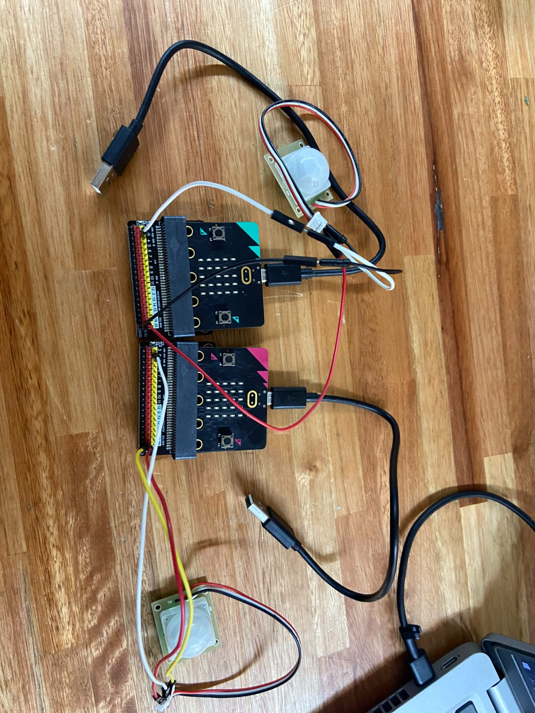

### Montaje y conexiones físicas

Comenzamos conectando los sensores PIR a las placas de expansión de las micro:bit mediante cables de conexión.

Para realizar el montaje utilizamos las siguientes conexiones:

| Sensor PIR | Placa de expansión | Función |
|------------|--------------------|---------|
| VCC (+) | 3V | Alimentación positiva |
| GND (-) | GND | Tierra o negativo |
| OUT (S) | P0 | Señal de detección de movimiento |

El pin P0 se utiliza para recibir la señal digital enviada por el sensor cuando detecta movimiento.

Por su parte, los pines VCC y GND permiten alimentar el sensor.

Una vez realizadas las conexiones, comenzamos las pruebas para comprobar si los sensores detectaban movimiento y si la micro:bit respondía mediante una alerta visual y sonora.

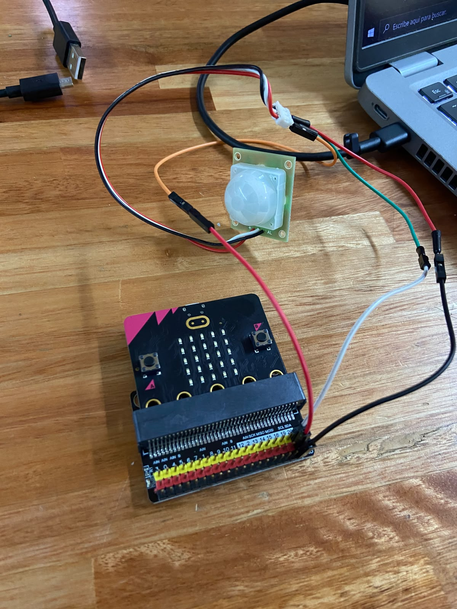

### Objetivo de las pruebas

Nuestro objetivo principal era conseguir que los sensores PIR detectaran movimiento y que la micro:bit activara una alarma sonora.

Para ello utilizamos como base el código que veníamos desarrollando durante las clases anteriores en MakeCode, utilizando el lenguaje Python.

En esta etapa nos concentramos únicamente en comprobar el funcionamiento de los sensores y la activación de la alarma.

### Evolución del sistema de alarma sonora

Durante las primeras etapas del proyecto realizamos simulaciones en Tinkercad, utilizando un componente piezoeléctrico para reproducir los sonidos de la alarma.

En aquella versión, el código utilizaba el pin P1 como salida de sonido para el piezoeléctrico.

Posteriormente decidimos retirar ese componente y aprovechar el parlante integrado de la micro:bit.

De esta manera, simplificamos el montaje físico, evitando la necesidad de conectar un dispositivo adicional para reproducir los sonidos.

### Código original — Versión con piezoeléctrico

El siguiente código corresponde a una versión anterior que utilizamos como base para desarrollar el sistema de alarma.

Incluye funciones para detectar movimiento, mostrar una alerta visual, reproducir sonidos mediante un piezoeléctrico y transmitir una señal por radio.

```python
radio.set_group(20)
radio.set_transmit_power(7)

PIR = DigitalPin.P0

def screen_alert():
    basic.show_icon(IconNames.ANGRY)
    basic.show_string("ALERT")

def sound_alert():
    pins.analog_set_pitch_pin(AnalogPin.P1)

    pins.analog_pitch(220, 200)
    basic.pause(1000)
    pins.analog_pitch(440, 200)
    basic.pause(1000)
    pins.analog_pitch(880, 200)
    basic.pause(1000)

def send_alert():
    radio.send_string("alert")

def on_received_string(mensaje):
    if mensaje == "alert":
        screen_alert()
        sound_alert()

radio.on_received_string(on_received_string)

movimiento_anterior = 0

def on_forever():
    global movimiento_anterior

    movimiento = pins.digital_read_pin(PIR)

    if movimiento == 1 and movimiento_anterior == 0:
        screen_alert()
        send_alert()
        sound_alert()

        movimiento_anterior = movimiento

        basic.pause(100)

basic.forever(on_forever)
```

Aunque este código contiene funciones de comunicación por radio, todavía no habíamos comenzado a realizar pruebas de esa funcionalidad.

Nuestro objetivo durante esta etapa era comprobar únicamente la detección de movimiento y la activación de la alarma.

### Adaptación al parlante integrado de la micro:bit

Al comenzar a trabajar con los componentes físicos, decidimos utilizar el parlante integrado de la micro:bit en lugar del piezoeléctrico previsto inicialmente.

Para esta adaptación trabajamos con las funciones de música de MakeCode, que permiten generar sonidos sin necesidad de conectar un dispositivo externo.

La siguiente función representa la adaptación prevista para utilizar el parlante integrado:

```python
def sound_alert():
    music.set_built_in_speaker_enabled(True)
    music.play_tone(220, 200)
    basic.pause(1000)
    music.play_tone(440, 200)
    basic.pause(1000)
    music.play_tone(880, 200)
    basic.pause(1000)
```

Esta versión mantiene la secuencia de tres sonidos utilizada anteriormente, pero aprovecha el parlante integrado de la micro:bit.

Para adaptar el sistema de alarma utilizamos MakeCode, configurando las funciones de alerta visual y sonora de la micro:bit. Posteriormente, realizamos pruebas físicas para comprobar su funcionamiento.

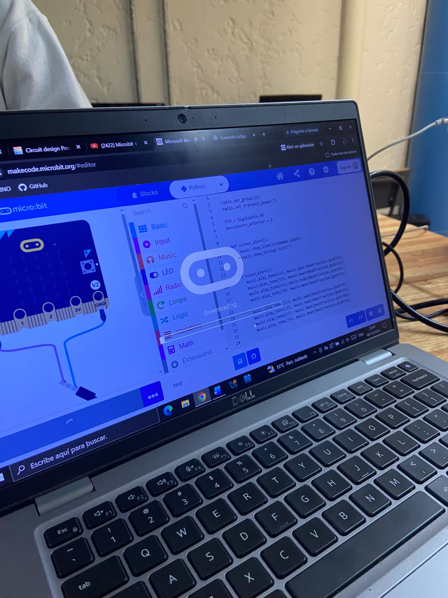

### Dificultades durante las pruebas

Después de realizar estas pruebas y revisar las conexiones entre las micro, las placas de expansión y los sensores PIR, no conseguimos obtener la respuesta esperada.

El principal inconveniente fue que no pudimos confirmar que los sensores enviaran correctamente la señal de detección de movimiento a la micro. Esto impidió verificar el funcionamiento completo del sistema.

### Pruebas individuales de los sensores PIR

Ante las dificultades encontradas, decidimos realizar pruebas específicas utilizando MakeCode.

Para ello utilizamos códigos más sencillos, destinados únicamente a comprobar si los sensores PIR detectaban movimiento y enviaban una señal a la micro:bit mediante el pin P0.

Realizamos varios intentos, pero continuamos sin obtener los resultados esperados.

A partir de estas pruebas, planteamos la hipótesis de que los sensores PIR podrían encontrarse dañados, aunque no pudimos confirmar definitivamente esta situación.

### Preparación para la próxima clase

Como parte de la preparación para la siguiente clase, durante el fin de semana conseguimos dos sensores PIR nuevos para repetir las pruebas físicas.

Nuestro próximo objetivo será conectar nuevamente los componentes y comprobar si los sensores detectan movimiento correctamente.

Una vez que logremos verificar la detección, continuaremos con las pruebas de activación de la alarma sonora mediante el parlante integrado de la micro:bit.

También quedó pendiente revisar el control de la variable `movimiento_anterior` para permitir nuevas detecciones después de que el sensor deje de registrar movimiento.

Por el momento, seguimos trabajando en esta primera etapa del proyecto, sin avanzar todavía hacia las pruebas de comunicación por radio ni el envío de mensajes o notificaciones a otros dispositivos.

### Conclusión

Aunque no conseguimos completar satisfactoriamente las pruebas físicas, esta clase representó un avance importante para el desarrollo del proyecto.

Después de las dificultades ocasionadas por el robo de materiales, logramos reunir nuevamente los componentes necesarios, retomar el montaje físico y realizar diferentes pruebas de funcionamiento.

Durante la jornada también trabajamos en la adaptación del código para utilizar el parlante integrado de la micro:bit y efectuamos pruebas individuales de los sensores PIR para intentar identificar el origen de los inconvenientes.

Si bien no pudimos confirmar que los sensores estuvieran dañados, establecimos los próximos pasos para continuar con las pruebas utilizando nuevos componentes.

El trabajo realizado nos permitió avanzar en la integración de los elementos físicos y la programación, acercándonos al objetivo de implementar un sistema capaz de detectar movimiento y activar una alarma mediante la micro:bit.


## 15/10/2026 — Pruebas de funcionamiento de los sensores PIR con Arduino

Durante la clase realizamos pruebas utilizando una placa Arduino para comprobar el funcionamiento de los sensores PIR, debido a los inconvenientes que habíamos tenido anteriormente al utilizarlos con la micro:bit.

Para realizar las pruebas, conectamos los sensores PIR a Arduino y utilizamos un código que permitía detectar movimiento mediante el encendido y apagado de los LED.

Durante las pruebas observamos que, al realizar movimientos frente al sensor, los LED se encendían y, cuando dejaba de detectar movimiento, se apagaban.

De esta manera, comprobamos visualmente que los sensores respondían correctamente al utilizar una alimentación de **5 V**, mientras que con **3 V** no obtuvimos los resultados esperados.

### Evidencia de la prueba

En el siguiente video se muestra el funcionamiento del sensor PIR conectado a Arduino, donde se puede observar la respuesta de los LED ante la detección de movimiento.

[Ver video de la prueba con Arduino](videos/Prueba_PIR_Arduino.mp4)

### Código utilizado en Arduino

Para realizar las pruebas utilizamos el siguiente código, que permite leer la señal del sensor PIR y controlar el encendido y apagado del LED integrado de Arduino según la detección de movimiento.

```cpp
const int MOTION_PIN = 2; // Pin conectado al sensor PIR

void setup()
{
  Serial.begin(9600);

  pinMode(MOTION_PIN, INPUT_PULLUP);
  pinMode(LED_BUILTIN, OUTPUT);
}

void loop()
{
  int proximity = digitalRead(MOTION_PIN);
  Serial.write(proximity);

  if (proximity == LOW)
  {
    digitalWrite(LED_BUILTIN, HIGH);
    Serial.println("Motion detected!");
  }
  else
  {
    digitalWrite(LED_BUILTIN, LOW);
  }

  delay(1000);
}
```

### Resultados obtenidos

Las pruebas realizadas permitieron comprobar que los sensores PIR funcionaban con Arduino al utilizar una alimentación de **5 V**.

A partir de estos resultados, continuamos realizando pruebas con la micro:bit y su placa de expansión para investigar las dificultades que presentaban los sensores al utilizarlos en nuestro proyecto **ALL DETECTED**.

---

### Pruebas con micro:bit y placa de expansión

Después de comprobar el funcionamiento de los sensores PIR con Arduino, continuamos realizando pruebas utilizando la micro:bit y su placa de expansión.

El objetivo fue intentar utilizar los sensores con una alimentación de **5 V**, debido a que en las pruebas anteriores no habíamos obtenido resultados satisfactorios con 3 V.

Durante esta etapa realizamos diferentes intentos, modificando las conexiones mediante jumpers, ajustando la sensibilidad de los sensores y probando distintas configuraciones.

También cargamos un código desarrollado en **MakeCode** para realizar la lectura del sensor PIR mediante el pin **P0**, activar las alertas visuales y sonoras y enviar una señal de alerta por radio.

Se realizaron pruebas con diferentes configuraciones de lectura, tanto digitales como analógicas, buscando obtener una respuesta del sensor.

Sin embargo, a pesar de los intentos realizados, no conseguimos que los sensores PIR funcionaran correctamente con la micro:bit.

Además, aunque intentamos utilizar una alimentación de 5 V mediante la placa de expansión, no pudimos confirmar ese valor mediante una medición.

### Código utilizado en MakeCode

El siguiente código corresponde a una de las versiones utilizadas durante las pruebas con micro:bit.

```python
radio.set_group(20)
radio.set_transmit_power(7)

PIR = DigitalPin.P0

def screen_alert():
    basic.show_icon(IconNames.ANGRY)
    basic.show_string("ALERT")

def sound_alert():
    pins.analog_set_pitch_pin(AnalogPin.P1)

    pins.analog_pitch(220, 200)
    basic.pause(1000)
    pins.analog_pitch(440, 200)
    basic.pause(1000)
    pins.analog_pitch(880, 200)
    basic.pause(1000)

def send_alert():
    radio.send_string("alert")

def on_received_string(mensaje):
    if mensaje == "alert":
        screen_alert()
        sound_alert()

radio.on_received_string(on_received_string)

movimiento_anterior = 0

#serial.redirect_to_usb()

def on_forever():
    #basic.show_icon(IconNames.HEART)
    global movimiento_anterior

    movimiento = pins.digital_read_pin(PIR)
    #movimiento = pins.analog_read_pin(AnalogPin.P0)

    #serial.write_value("x", movimiento)

    if movimiento == 1:
        led.plot(1, 1)
        basic.pause(50)
        led.unplot(1, 1)
    else:
        led.plot(2, 2)
        basic.pause(50)
        led.unplot(2, 2)

    if movimiento == 1 and movimiento_anterior == 0:
        #if False:
        screen_alert()
        send_alert()
        sound_alert()

        movimiento_anterior = movimiento

    basic.pause(100)
    #basic.show_icon(IconNames.SAD)

    led.plot(0, 0)
    basic.pause(50)
    led.unplot(0, 0)

basic.forever(on_forever)
```

### Resultados obtenidos

A diferencia de las pruebas realizadas con Arduino, no logramos obtener una respuesta satisfactoria de los sensores PIR utilizando la micro:bit.

Durante los ensayos modificamos conexiones, configuraciones y aspectos de la programación, pero no conseguimos resolver el inconveniente.

Estos resultados nos llevaron a evaluar, junto con el profesor, la posibilidad de utilizar otro tipo de sensor de detección que fuera más sencillo de implementar con micro:bit.

---


### Avances en la presentación de las maquetas

También quedaron prontas las dos maquetas que representan las viviendas del proyecto.

Ambas viviendas cuentan con puertas, ventanas, elementos decorativos y carteles identificadores. Además, se colocaron los nombres **Vivienda 1** y **Vivienda 2**, junto con el identificador del proyecto.

Estas mejoras permiten diferenciar las viviendas y presentar de forma más clara el escenario donde se implementará el sistema de detección de movimiento.

**Foto de las maquetas:**

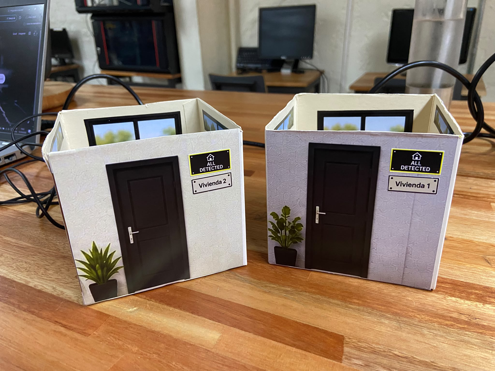

### Conclusiones y próximos pasos

Durante la clase comprobamos que los sensores PIR funcionaban correctamente al utilizarlos con Arduino y una alimentación de **5 V**.

Sin embargo, después de realizar diferentes pruebas con la micro:bit, modificar conexiones y probar distintas configuraciones de programación, no conseguimos obtener los resultados esperados.

A partir de estos inconvenientes, conversamos con el profesor sobre la posibilidad de reemplazar los sensores PIR por otro tipo de sensor, similar al utilizado por otro equipo, que ya había demostrado funcionar con micro:bit.

---


## 22/10/2026 — Pruebas del sensor ultrasónico HC-SR04 con Arduino

Durante la clase continuamos realizando pruebas con un sensor ultrasónico HC-SR04, como alternativa a los sensores PIR utilizados anteriormente.

Comenzamos conectando el sensor a una placa Arduino y utilizando Arduino IDE para comprobar su funcionamiento.

Sin embargo, no conseguimos obtener los resultados esperados, por lo que consideramos que el sensor podía estar dañado.

Ante esta situación, buscamos otros sensores en el Espacio Maker para continuar realizando las pruebas. Conseguimos tres sensores adicionales y decidimos retomar los ensayos utilizando la micro:bit y su placa de expansión.

### Evidencia fotográfica del sensor HC-SR04

**Fotografía pendiente:** se incorporará una imagen del sensor ultrasónico HC-SR04 en la próxima clase.

<!-- Cuando tengamos la fotografía, reemplazar el texto anterior por:

-->

### Pruebas del sensor HC-SR04 con micro:bit y placa de expansión

Después de los intentos realizados con Arduino, continuamos las pruebas utilizando una micro:bit y su placa de expansión, junto con los sensores ultrasónicos HC-SR04 que conseguimos en el Espacio Maker.

El objetivo era comprobar si podíamos utilizar estos sensores para detectar objetos a una distancia determinada.

Para ello realizamos las conexiones y cargamos un código desarrollado en MakeCode, utilizando el pin P0 para enviar la señal de activación del sensor y el pin P1 para recibir la respuesta.

El programa estaba diseñado para calcular la distancia y mostrar un corazón en la pantalla de la micro:bit cuando detectara un objeto a menos de **10 centímetros**.

Sin embargo, durante las pruebas surgieron dificultades relacionadas con el voltaje necesario para utilizar el sensor. No pudimos comprobar de forma segura su funcionamiento debido al riesgo de aplicar una tensión incompatible con la micro:bit.

Por este motivo, no conseguimos completar satisfactoriamente las pruebas de detección de distancia.

### Código utilizado en MakeCode

Para realizar estas pruebas utilizamos un programa que enviaba una señal de activación al sensor, recibía su respuesta y calculaba la distancia aproximada al objeto.

El código establecía un límite de detección de 10 centímetros y utilizaba la pantalla LED de la micro:bit como indicador visual.

```python
def on_forever():
    pins.digital_write_pin(DigitalPin.P0, 0)
    control.wait_micros(2)
    pins.digital_write_pin(DigitalPin.P0, 1)
    control.wait_micros(10)
    pins.digital_write_pin(DigitalPin.P0, 0)

    tiempo = pins.pulse_in(
        DigitalPin.P1,
        PulseValue.HIGH,
        30000
    )

    distancia = tiempo * 0.0343 / 2

    if tiempo > 0 and distancia < 10:
        basic.show_icon(IconNames.HEART)
    else:
        basic.clear_screen()

    basic.pause(100)

basic.forever(on_forever)
```

### Resultados obtenidos

A pesar de los intentos realizados, no logramos verificar correctamente el funcionamiento de los sensores ultrasónicos HC-SR04 con la micro:bit.

La principal dificultad estuvo relacionada con la alimentación y los niveles de voltaje del sensor, por lo que decidimos no continuar con conexiones que pudieran comprometer el funcionamiento de la placa.

---

### Pruebas de comunicación mediante ESP32, MQTT y Python

Durante la clase comenzamos a trabajar en una alternativa para implementar el envío de notificaciones externas mediante una conexión a Internet.

Para realizar las pruebas utilizamos una placa ESP32 simulada en Wokwi, debido a que el Arduino Uno disponible en ese entorno no contaba con conectividad a Internet.

El objetivo era establecer una comunicación entre la ESP32 y un programa desarrollado en Python, utilizando el protocolo MQTT.

Para ello utilizamos un servidor MQTT como intermediario, permitiendo que la ESP32 publicara mensajes y que Python pudiera recibirlos mediante la biblioteca `paho-mqtt`.

### Pruebas realizadas

Primero configuramos la ESP32 para conectarse a una red Wi-Fi y publicar periódicamente el mensaje `ENVIAR_CORREO`.

Posteriormente trabajamos con un programa Python llamado `receptor.py`, encargado de recibir los mensajes y gestionar el intento de envío de una notificación mediante Gmail.

Ejecutamos el programa desde PowerShell. Durante los primeros intentos surgieron errores de conexión y ejecución, que fuimos revisando hasta conseguir establecer la comunicación.

Finalmente, logramos que la ESP32 enviara los mensajes y que Python los recibiera correctamente.

### Código utilizado en ESP32 (Wokwi)

El siguiente código permite conectar la ESP32 a Wi-Fi y publicar el mensaje `ENVIAR_CORREO` cada cinco segundos.

```cpp
#include <WiFi.h>
#include <PubSubClient.h>

const char* ssid = "Wokwi-GUEST";
const char* password = "";

const char* mqtt_server = "broker.hivemq.com";
const int mqtt_port = 1883;

const char* tema = "arduino-internet-prueba-84721";

WiFiClient conexionWiFi;
PubSubClient clienteMQTT(conexionWiFi);

void conectarMQTT() {
  while (!clienteMQTT.connected()) {
    Serial.print("Conectando al servidor MQTT...");

    if (clienteMQTT.connect("ESP32-Wokwi-Prueba-84721")) {
      Serial.println(" conectado!");
    } else {
      Serial.print(" Error: ");
      Serial.println(clienteMQTT.state());
      delay(3000);
    }
  }
}

void setup() {
  Serial.begin(115200);

  WiFi.begin(ssid, password);

  Serial.print("Conectando al Wi-Fi...");
  while (WiFi.status() != WL_CONNECTED) {
    delay(500);
    Serial.print(".");
  }

  Serial.println("\nWi-Fi conectado!");

  clienteMQTT.setServer(mqtt_server, mqtt_port);

  conectarMQTT();
}

void loop() {
  if (!clienteMQTT.connected()) {
    conectarMQTT();
  }

  clienteMQTT.loop();

  clienteMQTT.publish(tema, "ENVIAR_CORREO");
  Serial.println("Mensaje enviado: ENVIAR_CORREO");

  delay(5000);
}
```

### Código utilizado en Python (receptor.py)

Este programa permite recibir los mensajes enviados desde la ESP32 y contiene una función para intentar enviar un correo electrónico mediante Gmail.

```python
import os
import smtplib
import getpass
from email.message import EmailMessage

import paho.mqtt.client as mqtt

# Configuración MQTT
BROKER = "broker.hivemq.com"
PUERTO = 1883

# IMPORTANTE: cambia este tema por uno largo y único.
# Usa exactamente el mismo tema en Wokwi.
TEMA = "arduino-internet-prueba-84721"

# Datos del correo
REMITENTE = input("Tu dirección de Gmail: ")
DESTINATARIO = input("Correo destinatario: ")
CLAVE_APP = getpass.getpass("Contraseña de aplicación de Gmail: ")
correo_enviado = False


def enviar_correo():
    mensaje = EmailMessage()
    mensaje["Subject"] = "Prueba desde Arduino"
    mensaje["From"] = REMITENTE
    mensaje["To"] = DESTINATARIO
    mensaje.set_content(
        "¡Funciona! Python recibió la instrucción de la ESP32 virtual."
    )

    with smtplib.SMTP("smtp.gmail.com", 587, timeout=30) as servidor:
        servidor.set_debuglevel(1)
        servidor.ehlo()
        servidor.starttls()
        servidor.ehlo()
        servidor.login(REMITENTE, CLAVE_APP)
        servidor.send_message(mensaje)

    print("¡Correo enviado correctamente!")


def al_conectar(cliente, datos, flags, razon_codigo, propiedades):
    print("Conectado al servidor MQTT")
    cliente.subscribe(TEMA)
    print("Esperando mensajes...")


def al_recibir(cliente, datos, mensaje):
    global correo_enviado

    texto = mensaje.payload.decode("utf-8")
    print("Mensaje recibido:", texto)

    if texto == "ENVIAR_CORREO" and not correo_enviado:
        correo_enviado = True

        try:
            enviar_correo()
        except Exception as error:
            correo_enviado = False
            print("Error al enviar el correo:", error)


cliente = mqtt.Client(
    callback_api_version=mqtt.CallbackAPIVersion.VERSION2
)

cliente.on_connect = al_conectar
cliente.on_message = al_recibir

print("Conectando al servidor MQTT...")
cliente.connect(BROKER, PUERTO, 60)
cliente.loop_forever()
```


### Evidencias de las pruebas

**Conexión de Python al servidor MQTT**

Durante las pruebas utilizamos Python para establecer una conexión con el servidor MQTT, con el objetivo de recibir los mensajes enviados desde la ESP32 simulada en Wokwi.

La siguiente captura muestra que logramos establecer la conexión y que el programa quedó a la espera de mensajes.

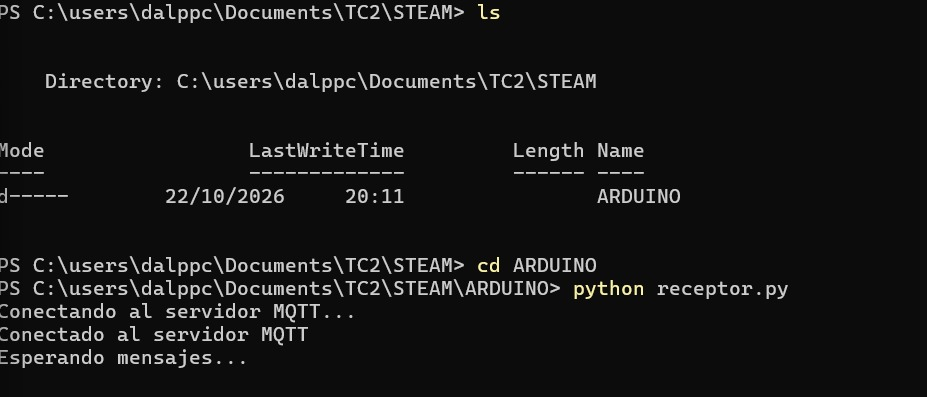

**Comunicación entre ESP32 y Python mediante MQTT**

Continuamos las pruebas configurando la ESP32 para enviar el mensaje `ENVIAR_CORREO` mediante el servidor MQTT.

Como se observa en la siguiente captura, logramos transmitir el mensaje desde Wokwi y recibirlo correctamente mediante Python.

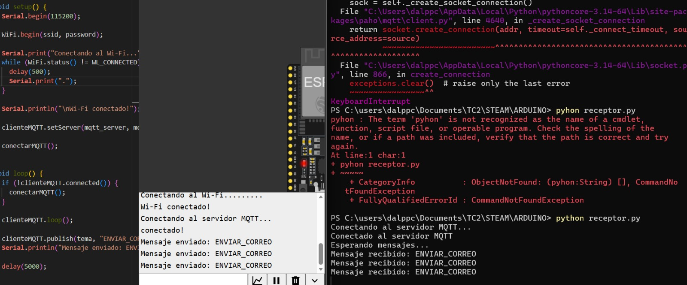

### Resultados obtenidos

Logramos establecer la comunicación entre la ESP32 simulada en Wokwi y Python mediante el protocolo MQTT.

Esta prueba nos permitió avanzar en el desarrollo de un mecanismo para enviar notificaciones externas cuando se detecte movimiento.

Sin embargo, el envío de la notificación por correo electrónico quedó pendiente de completar, por lo que continuaremos trabajando en esta funcionalidad durante las próximas clases.


## 29/10/2026 — Última prueba con sensor PIR y adaptación al sensor ultrasónico HC-SR04

### Última prueba con el sensor PIR

Durante esta clase realizamos una última prueba con el sensor PIR, utilizando un código proporcionado por el profesor para comprobar las lecturas del sensor y verificar si respondía correctamente.

Para esta prueba decidimos realizar una conexión directa entre la micro:bit y el sensor PIR, sin utilizar la placa de expansión ni los cables macho-hembra que veníamos usando anteriormente. En su lugar, utilizamos cables con pinzas cocodrilo.

Para facilitar la visualización de las conexiones, colocamos el sensor PIR al revés, dejando visibles los conectores y los cables utilizados durante la prueba.

#### Conexiones realizadas

| micro:bit | Sensor PIR | Color del cable |
|---|---|---|
| P0 | OUT (señal, pin central) | Negro |
| 3V | VCC (+3V) | Verde |
| GND | GND | Amarillo |

Para mostrar con mayor claridad cómo realizamos las conexiones, elaboramos un diagrama y tomamos fotografías del montaje utilizado.

#### Diagrama de conexiones

El siguiente diagrama representa las conexiones realizadas entre la micro:bit y el sensor PIR, identificando los pines utilizados y los colores de los cables.

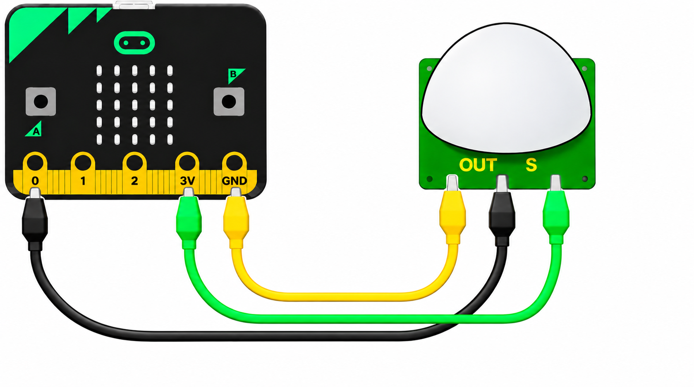

#### Montaje de la última prueba

En las siguientes fotografías se observa la conexión directa que realizamos entre la micro:bit y el sensor PIR utilizando pinzas cocodrilo, sin necesidad de la placa de expansión. Aunque las conexiones se pueden apreciar en las fotografías, el diagrama anterior permite identificar con mayor facilidad los pines utilizados y los colores de cada cable. Cabe aclarar que el sensor PIR se encuentra colocado al revés.

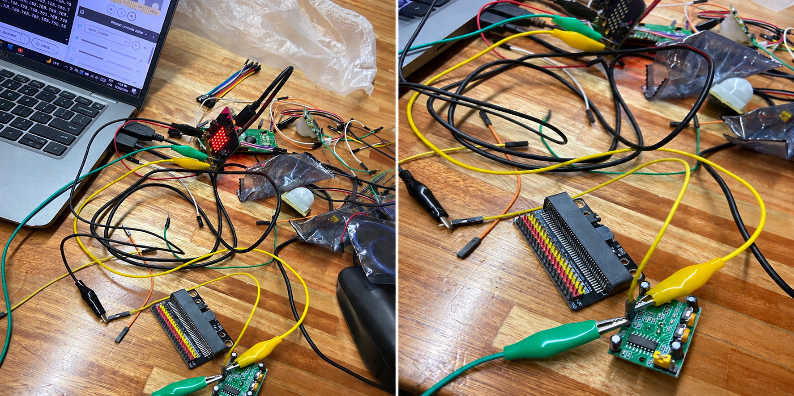

#### Código utilizado en la prueba

Para realizar esta última prueba utilizamos un código proporcionado por el profesor, desarrollado en Python para micro:bit.

El programa permitía leer los valores del pin P0 y mostrarlos en la consola serial. También mostraba diferentes imágenes en la pantalla de la micro:bit según la lectura digital del sensor.

El código utilizado se encuentra disponible en el siguiente enlace:

[Ver código de la última prueba PIR](codigos_avance3/Prueba_PIR.py)

#### Lecturas obtenidas

Durante las pruebas observamos que inicialmente se mostraban valores de 0, incluso cuando no se registraban movimientos.

Posteriormente, comenzaron a aparecer lecturas superiores a 700, principalmente alrededor de 768 y 769. Sin embargo, estos valores permanecían prácticamente constantes, sin presentar cambios claros al realizar movimientos frente al sensor.

La siguiente fotografía muestra los valores obtenidos en la consola serial durante esta prueba.

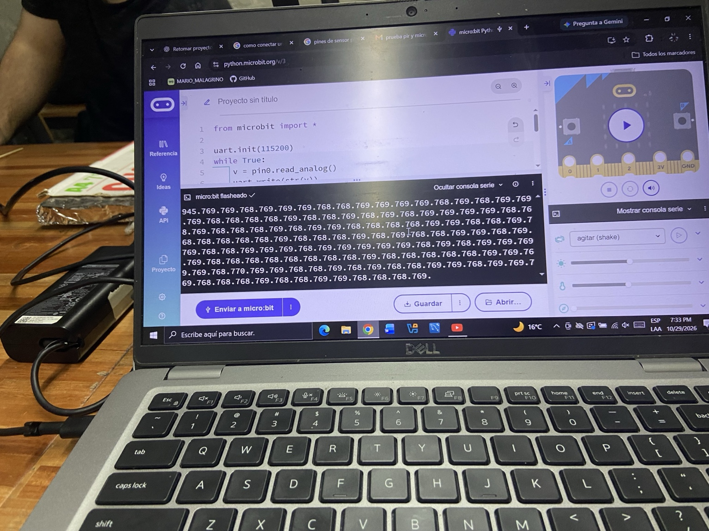

#### Conclusión de la prueba

Esta fue la última prueba que realizamos con el sensor PIR. A pesar de modificar las conexiones y utilizar el código proporcionado por el profesor, no logramos obtener una respuesta confiable para detectar movimientos.

Debido al tiempo dedicado a estas pruebas y a las dificultades encontradas, decidimos dejar de trabajar con el sensor PIR y continuar el desarrollo del proyecto utilizando un sensor ultrasónico de distancia HC-SR04.


### Adaptación al sensor ultrasónico HC-SR04

Luego de realizar la última prueba con el sensor PIR y no obtener resultados confiables, decidimos continuar el desarrollo del proyecto utilizando un sensor ultrasónico de distancia HC-SR04.

El objetivo de este cambio fue encontrar una alternativa que nos permitiera detectar la presencia de personas u objetos mediante la medición de distancias.

A diferencia del sensor PIR, que detecta cambios en la radiación infrarroja, el HC-SR04 utiliza ondas ultrasónicas para calcular la distancia entre el sensor y un objeto.

#### Conexión del sensor ultrasónico HC-SR04

Para comenzar las pruebas utilizamos una micro:bit, una placa de expansión y el sensor ultrasónico HC-SR04.

Este sensor cuenta con cuatro conectores: VCC, TRIG, ECHO y GND. Cada uno cumple una función necesaria para realizar las mediciones de distancia.

La siguiente tabla muestra las conexiones recomendadas y la función de cada conector:

| Sensor HC-SR04 | Conectar a | Función |
|---|---|---|
| VCC | 5V de la placa de expansión | Alimentación eléctrica del sensor |
| TRIG | P0 (SIG) | Envía el pulso que inicia la medición |
| ECHO | P1 (SIG), mediante divisor de tensión | Recibe la señal para calcular la distancia |
| GND | GND de la placa de expansión | Conexión a tierra |

El sensor HC-SR04 convencional utiliza una alimentación de 5V, mientras que la micro:bit trabaja con señales de 3,3V. Por este motivo, para realizar una conexión segura, es necesario adaptar la señal ECHO mediante un divisor de tensión.

La tabla muestra las conexiones recomendadas. A continuación, documentamos el montaje que realizamos durante la clase.

#### Diagrama de conexiones

Para representar las conexiones utilizadas durante la prueba, elaboramos un diagrama que muestra la micro:bit, la placa de expansión y el sensor ultrasónico HC-SR04.

En la imagen se pueden identificar los cuatro conectores del sensor, los cables utilizados y su disposición en la placa de expansión.

Este diagrama nos permite visualizar de forma más sencilla el montaje realizado durante la clase.

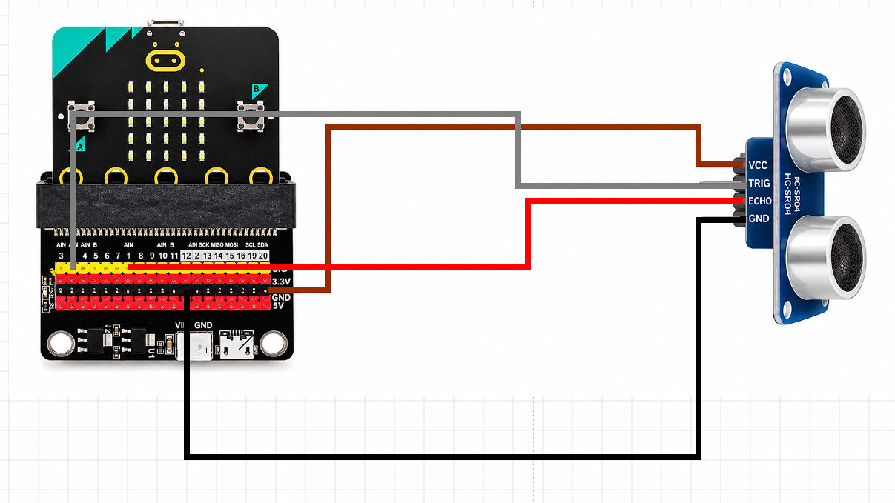

#### Montaje real del sensor ultrasónico

En la siguiente fotografía se observa cómo quedó conectado el sensor ultrasónico HC-SR04 a la micro:bit mediante la placa de expansión.

Se pueden apreciar los componentes utilizados, la distribución de los cables y el montaje que empleamos para realizar las primeras pruebas de medición de distancia.

La fotografía complementa el diagrama anterior, mostrando cómo quedó armado el circuito durante la clase.

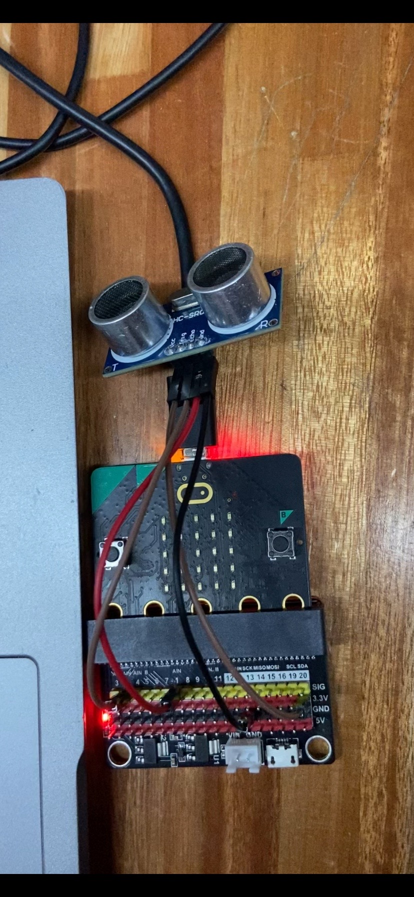

#### Código utilizado en la prueba

Para comprobar el funcionamiento del sensor ultrasónico HC-SR04 utilizamos un código desarrollado en Python para micro:bit.

El programa enviaba una señal desde el pin P0 y recibía la respuesta mediante el pin P1, permitiendo calcular la distancia en centímetros.

Durante la prueba, los resultados se mostraban en la consola serial y en la pantalla de la micro:bit. Cuando no se recibía una señal de retorno, el programa mostraba el mensaje `ERROR: No se recibe eco`.

El código utilizado se encuentra disponible en el siguiente enlace:

[Ver código de la primera prueba del sensor HC-SR04](codigos_avance3/Prueba_HC-SR04.py)

#### Primera prueba de funcionamiento del sensor HC-SR04

Una vez realizado el montaje, comenzamos a comprobar el funcionamiento del sensor ultrasónico mediante un programa de medición de distancias.

Durante esta primera prueba utilizamos la mano, acercándola al sensor para observar cómo respondía ante diferentes distancias.

Cuando el sensor no recibía una señal de retorno, el programa mostraba el mensaje `ERROR: No se recibe eco`.

Sin embargo, al acercar la mano frente al sensor, comenzaron a aparecer mediciones como `Distancia: 11 cm`, entre otros valores, según la posición de la mano.

Esto nos permitió comprobar que el sensor respondía al acercar la mano, registrando distancias que podrían utilizarse para identificar movimientos.

#### Video de la primera prueba

En el siguiente video se observa el funcionamiento del sensor ultrasónico HC-SR04 durante la prueba realizada en clase.

La grabación muestra cómo el programa alternaba entre el mensaje `ERROR: No se recibe eco` y las mediciones de distancia obtenidas al acercar la mano al sensor.

[Ver video de la primera prueba del sensor HC-SR04](videos/Primera_Prueba_HC-SR04.mp4)

#### Resultados obtenidos

Durante esta primera prueba logramos registrar mediciones utilizando el sensor ultrasónico HC-SR04. Al acercar la mano frente al sensor, el programa comenzó a mostrar valores de distancia, lo que nos permitió observar una respuesta ante la presencia de un objeto.

Si bien el funcionamiento todavía no era completamente estable, esta prueba fue importante para evaluar una alternativa al sensor PIR.


### Adaptación del sensor ultrasónico al sistema de alertas

Luego de comprobar que el sensor ultrasónico HC-SR04 respondía al acercar la mano, continuamos trabajando en la programación para adaptarlo al sistema de alertas de nuestro proyecto ALL DETECTED.

Para esta segunda prueba tomamos como referencia el sistema que habíamos desarrollado anteriormente en Tinkercad, adaptando el código para utilizar el sensor ultrasónico en lugar del PIR.

Nuestro objetivo fue aprovechar las mediciones de distancia para identificar la presencia de una persona u objeto y activar las alertas visuales y sonoras que habíamos trabajado en las clases anteriores.

#### Funcionamiento de la segunda prueba

Configuramos el programa para que, cuando el sensor registrara una distancia de 50 centímetros o menos, se activara una alerta en la micro:bit.

Durante la prueba, el programa mostraba en la consola serial las distancias registradas por el sensor ultrasónico HC-SR04.

Al acercar la mano y alcanzar la distancia configurada, la micro:bit mostraba el mensaje `ALERT` y reproducía tres tonos diferentes mediante su parlante integrado.

El código también incluía una cara de enojo (`Image.ANGRY`) como alerta visual, aunque durante la demostración no llegaba a distinguirse claramente debido a la rapidez con la que aparecía en la pantalla.

Además, incorporamos una condición para evitar que la alarma se repitiera constantemente. Una vez activada, el programa permitía una nueva alerta cuando la distancia superaba los 55 centímetros y posteriormente volvía a alcanzar el límite establecido.

El código también contemplaba el envío de un mensaje por radio a una segunda micro:bit, aunque en esta prueba nos concentramos en comprobar las alertas visuales y sonoras.

#### Código utilizado

Para realizar esta segunda prueba adaptamos el código anterior, incorporando las funciones necesarias para activar las alertas a partir de las mediciones del sensor ultrasónico.

El programa incluía la lectura de distancias, la visualización del mensaje `ALERT`, la reproducción de tres tonos y el control para evitar la repetición constante de la alarma.

El código utilizado se encuentra disponible en el siguiente enlace:

[Ver código de alerta con sensor HC-SR04](codigos_avance3/Alerta_HC-SR04.py)

#### Video de demostración

En el siguiente video se observa el funcionamiento del sistema de alertas utilizando el sensor ultrasónico HC-SR04.

Durante la demostración acercamos la mano al sensor y observamos cómo el programa registraba las distancias en la consola serial.

Al alcanzar la distancia configurada, la micro:bit mostraba el mensaje `ALERT` y reproducía los tres tonos programados.

[Ver video de la segunda prueba con alertas](videos/Segunda_Prueba_Alerta_HC-SR04.mp4)

#### Resultados obtenidos

En esta segunda prueba logramos activar correctamente el mensaje `ALERT` y los tres tonos utilizando las mediciones del sensor ultrasónico HC-SR04.

Esto representa un avance importante para ALL DETECTED, ya que recuperamos el funcionamiento del sistema de alertas desarrollado anteriormente y lo adaptamos al nuevo sensor.

Nuestro objetivo no es conocer la distancia exacta de un objeto, sino aprovechar las mediciones del sensor para identificar la presencia de personas u objetos dentro de una zona determinada.

De esta manera, el sensor ultrasónico comienza a cumplir la función que originalmente habíamos pensado para el PIR, permitiéndonos activar las alertas visuales y sonoras.

A partir de estos resultados, continuamos con la integración del sistema completo, incorporando la comunicación entre las dos micro:bit y las alertas que muestran diferentes imágenes en pantalla.

Esta siguiente etapa nos permite avanzar hacia la demostración del funcionamiento de ALL DETECTED utilizando las dos viviendas del proyecto.
