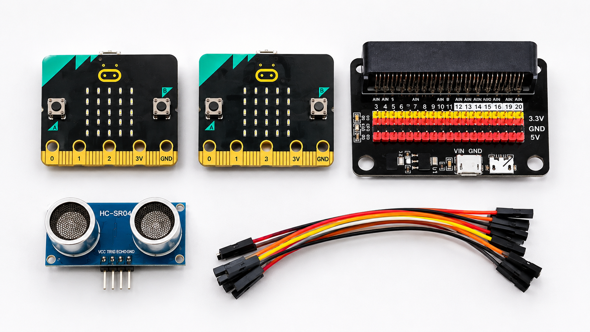
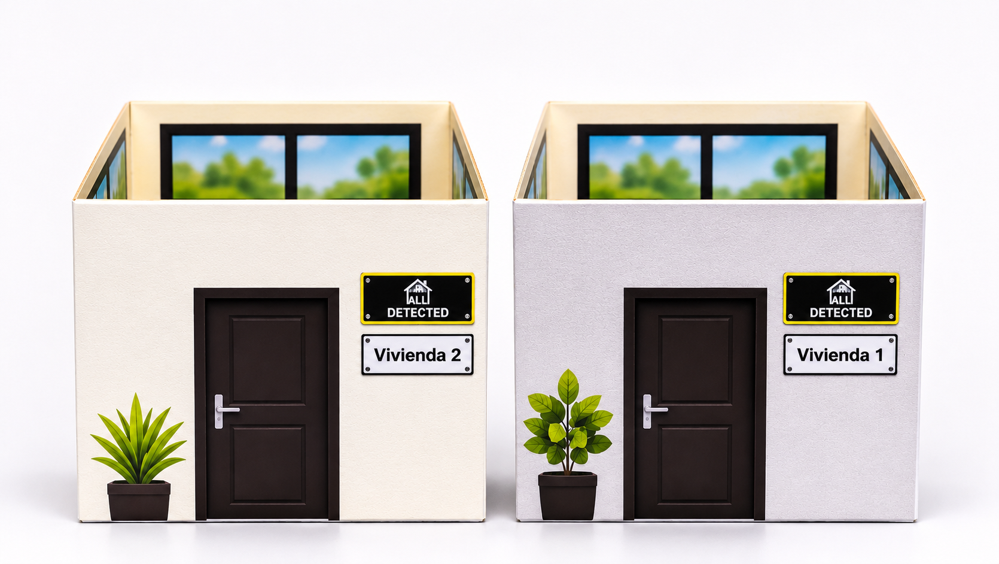
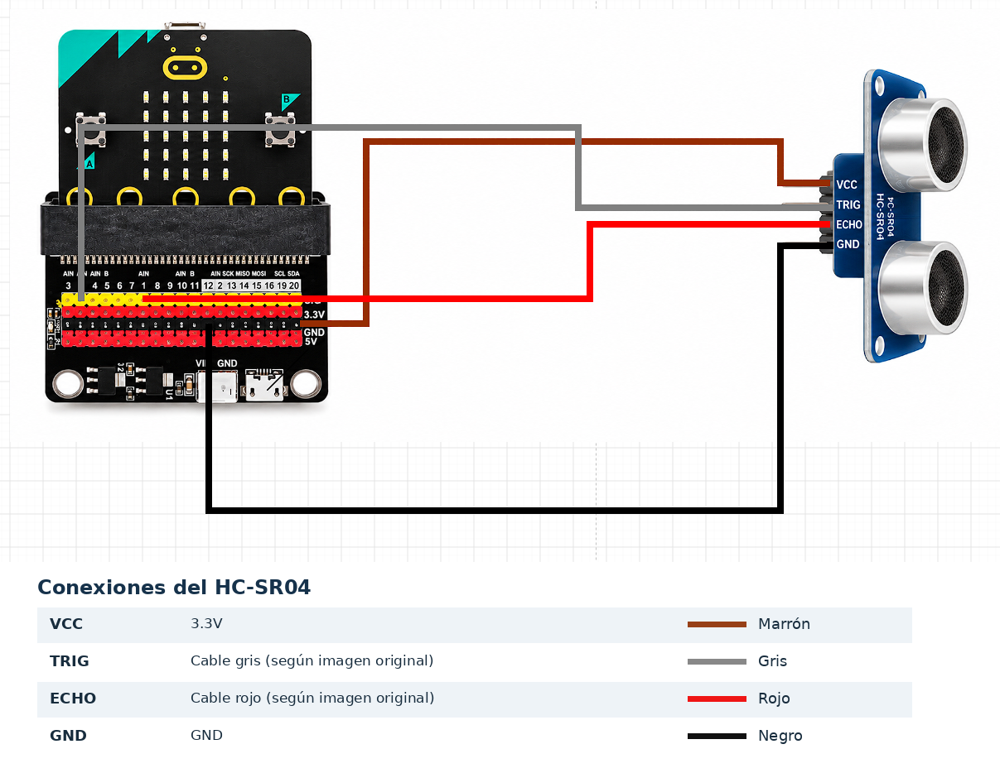

# Documentación Técnica

*Período: Segundo semestre de 2026*

Este documento contiene la documentación técnica del proyecto **ALL DETECTED**, desarrollado para el curso **Laboratorio STEAM+** de la tecnicatura **Redes y Software** del **Instituto Tecnológico de Informática (ITI)** de **UTU**, año 2026.

# Proyecto: ALL DETECTED

## 1. Integrantes

- Rafael Nunes
- Damián Márquez
- Simón Burgués
- Lucas Belén

## 2. Descripción

**ALL DETECTED** es un proyecto de seguridad que busca detectar posibles movimientos o presencias no autorizadas en una vivienda y comunicar una alerta a otro espacio.

El sistema utiliza placas micro:bit V2 y un sensor ultrasónico HC-SR04 para representar una situación en la que una vivienda es vigilada y otra recibe una advertencia mediante señales visuales y sonoras.

El objetivo de ALL DETECTED es contribuir a la seguridad de las viviendas, permitiendo detectar posibles movimientos relacionados con un intento de robo y enviar una alerta a otra vivienda, para que sus ocupantes puedan tomar conocimiento de la situación y actuar a tiempo.

---

## 3. Componentes utilizados

Para la construcción de ALL DETECTED se utilizaron los siguientes componentes electrónicos y materiales:

| Componente | Cantidad | Función |
|---|---|---|
| micro:bit V2 | 2 | Procesar información, comunicarse por radio y generar alertas. |
| Sensor ultrasónico HC-SR04 | 1 | Medir la distancia a objetos cercanos. |
| Placa de expansión | 1 | Facilitar la conexión del sensor con la micro:bit. |
| Cables de conexión | Varios | Conectar los componentes electrónicos. |
| Maquetas | 2 | Representar las viviendas del sistema. |

---

## 4. Diseño mecánico

Para representar el funcionamiento del sistema se construyeron dos maquetas que simulan viviendas independientes. Ambas cuentan con paredes, puertas y ventanas, permitiendo identificar los espacios utilizados durante la demostración.

La **Vivienda 1** representa el lugar que se desea vigilar. En este espacio se dispone el sistema de detección, compuesto por una micro:bit, una placa de expansión y el sensor ultrasónico HC-SR04.

La **Vivienda 2** representa el lugar desde donde se recibe la advertencia. Para ello, se utiliza una segunda micro:bit, que permite representar la recepción de una alerta desde otra vivienda.

Esta distribución permite demostrar una posible aplicación del proyecto en situaciones donde se necesita vigilar un espacio y comunicar una advertencia a otro lugar.

*Pendiente: incorporar fotografías reales de la ubicación y distribución de los componentes durante la próxima clase.*

---

## 5. Diseño electrónico

El diseño electrónico de ALL DETECTED se basa en la conexión del sensor ultrasónico HC-SR04 a una micro:bit V2 mediante una placa de expansión, además de la comunicación inalámbrica entre dos placas.

### Conexión del sensor HC-SR04

El sensor utiliza cuatro terminales: VCC para la alimentación, GND para la conexión a tierra, TRIG para emitir el pulso de medición y ECHO para recibir la señal de retorno.

Las conexiones se representan en el siguiente diagrama, respetando los colores y recorridos utilizados durante el montaje.

| Terminal | Conexión | Color del cable |
|---|---|---|
| VCC | 3.3V | Marrón |
| TRIG | Pin de señal según el diagrama original | Gris |
| ECHO | Pin de señal según el diagrama original | Rojo |
| GND | GND | Negro |

*Figura 3. Diagrama de conexiones del sensor HC-SR04 con la micro:bit y la placa de expansión.*

### Comunicación entre las micro:bit

La primera micro:bit cumple la función de **emisora**, encargada de procesar las mediciones del sensor y transmitir un mensaje de alerta cuando se cumple la condición programada.

La segunda funciona como **receptora**, recibiendo el mensaje mediante radio. De esta manera, ambas placas pueden comunicarse sin necesidad de una conexión física entre ellas.

---

## 6. Desarrollo del software

La programación de ALL DETECTED se desarrolla mediante **MakeCode**, utilizando programas independientes para controlar la micro:bit emisora y la receptora.

### Programación de la emisora

El programa se encarga de obtener las mediciones del sensor HC-SR04, evaluar la distancia detectada y determinar cuándo corresponde generar una alerta.

Cuando se cumple la condición establecida, se prevé activar una advertencia visual y sonora y transmitir un mensaje por radio a la segunda micro:bit.

*Pendiente: incorporar el código definitivo y sus principales funciones.*

### Programación de la receptora

El programa de la segunda micro:bit está destinado a recibir los mensajes enviados por radio y activar las advertencias correspondientes mediante su pantalla LED y el parlante integrado.

*Pendiente: incorporar el código definitivo y verificar el funcionamiento de las alertas.*

### Activación y desactivación mediante contraseña

*Apartado pendiente de desarrollo. En la próxima clase vamos a trabajar en la implementación de una contraseña mediante los botones A y B de la micro:bit, que nos permitirá activar y desactivar el sistema de seguridad.*

*Una vez realizada la programación y comprobado su funcionamiento, completaremos esta sección con la explicación técnica y las pruebas correspondientes.*

### Pruebas de funcionamiento

*Pendiente: realizar video del funcionamiento completo.*

---

## 7. Referencias y recursos

**Repositorio de GitHub:** https://github.com/Damustin/all_detected

**Documentación de los avances:**

- [Avance 1](https://github.com/Damustin/all_detected/blob/branch-auxiliary/documentacion/avance1.md)
- [Avance 2](https://github.com/Damustin/all_detected/blob/branch-auxiliary/documentacion/avance2.md)
- [Avance 3](https://github.com/Damustin/all_detected/blob/branch-auxiliary/documentacion/avance3.md)

**Herramienta de programación:** MakeCode para micro:bit.
